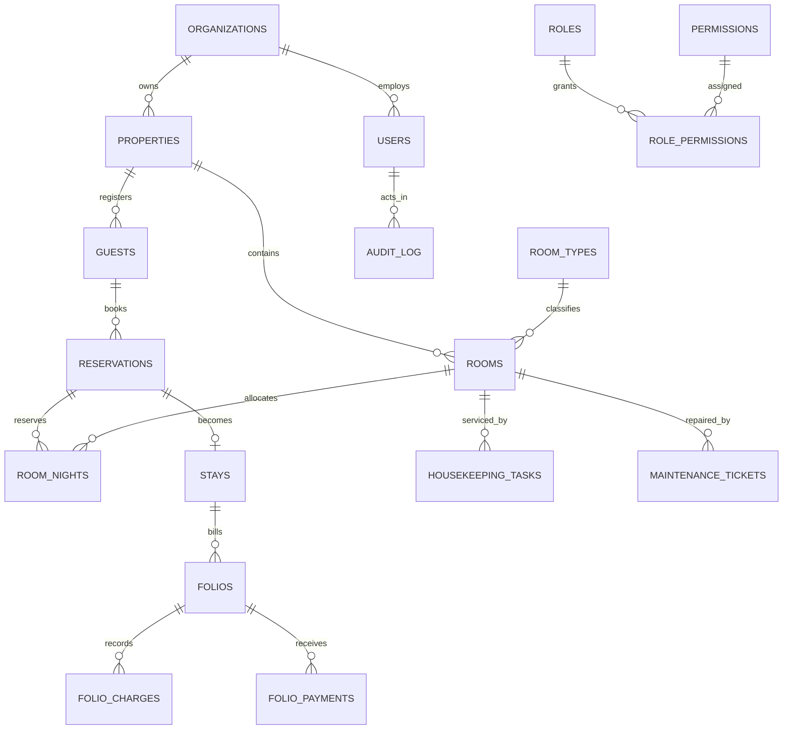

# Decisions

## Phase 1

- **Project folders:** the user selected the existing `backend/` and `frontend/` directories as the canonical project layout. Phase 1 files live there, and the workspace paths in `PROJECT_SPEC.md` were updated accordingly.
- **Runtime compatibility:** the implementation targets Node.js 20 LTS as specified. Initial local scaffolding is being prepared with the available Node.js 22.14.0; CI is pinned to Node 20.
- **Database creation:** `db:create` connects to the server without selecting a database, then creates the configured database with utf8mb4. The default collation is MySQL 8's `utf8mb4_0900_ai_ci`.
- **Health response:** `/api/health` returns HTTP 200 when the DB responds and HTTP 503 when it does not, using the standard `{ data }` / `{ error }` response shape.
- **UI foundation:** the initial dashboard is a visual shell with sample summary data. Operational routes are clearly marked as scheduled-phase placeholders; they do not claim to be implemented.
- **Test runner security update:** npm's full advisory report identified three advisories in Vitest 3's dependency tree. Vitest was upgraded to 4.1.12; dependency installation reported zero vulnerabilities afterward.
- **Authentication dependency security:** the authentication install exposed advisories in bcrypt 5's `node-pre-gyp`/`tar` installer chain. bcrypt was upgraded to 6.0.0; `npm audit` now reports zero vulnerabilities.
- **CI verification boundary:** GitHub Actions is configured for Node.js 20 and MySQL 8.0, but the hosted workflow has not been run from this workspace.
- **Workspace relocation:** the original lockfile was regenerated for the selected `backend/` and `frontend/` workspaces; `package-lock.json` is now aligned with the root npm workspace definitions.

# Phase 2 schema overview

Operational tables are scoped by `property_id`; shared organization and platform configuration tables are the exceptions. The initial migration uses InnoDB foreign keys and explicit unique constraints for room numbers, reservation confirmation numbers, and room-night allocation.

## Phase 3 authentication and authorization

- **Session transport:** 15-minute signed JWT access tokens are kept in frontend memory; refresh tokens are random opaque values persisted only as SHA-256 hashes, rotated on refresh, and placed in an HttpOnly, SameSite=Strict cookie for browser sessions. Refresh-token reuse revokes the entire family. The signing secret is configured by `JWT_ACCESS_SECRET` and is mandatory in production.
- **Concurrent refresh:** the browser client shares a single in-flight refresh request so React development Strict Mode or parallel 401 retries cannot accidentally reuse a token during rotation.
- **Lockout:** a user row lock protects failed-login counters. Five consecutive failures lock the account for 15 minutes; successful login clears the counters.
- **Tenant scope:** authenticated claims carry organization, assigned property IDs, and active property ID. Property-scoped middleware revalidates the active property against `user_properties` and the organization's active properties on each request. The request body is never used to choose a regular operation's property scope.
- **Permission policy:** permission keys and the nine role defaults are defined in one backend module and shared by seed logic. Permission reads are cached for 30 seconds; role permission updates invalidate the local cache immediately.
- **Administration:** organization roles can be customized, but `super_admin.manage` cannot be granted to an organization role. User property assignments must be among the acting user's property assignments.
- **Audit integrity:** security-sensitive user, password, and role changes record before/after snapshots in the same transaction as the change. Database triggers reject updates and deletes from `audit_log`.
- **Property repository:** property-bound inserts inject the trusted property ID; selects and updates constrain on it. Callers cannot override it through a values object.

## Phase 4 property configuration and rate calculation

- **Scope:** every property-config API validates an active property membership from the signed session. Business date remains read-only in profile updates; Phase 8 night audit owns advancement.
- **Room-type amenities:** a `room_type_amenities` join table associates amenities with room types without overloading the separate room-specific `room_amenities` table.
- **Bulk room creation:** ranges are limited to 100 rooms per request, prechecked for duplicates, and inserted with one transaction and one audit event. Active/future reservations prevent room deactivation.
- **Rate precedence:** date ranges include their end date. Matching rules are filtered by property, room type, plan and weekday; latest `date_from` wins, followed by latest `created_at`, then highest ID. A type's base rate applies where no rule matches.
- **Rate access:** `rates.view` allows front desk to retrieve rate plans, room types and quotes for future reservation workflows without granting the separate `rates.edit` capability.
- **Past rates:** creating or modifying a rate whose interval overlaps the property's business date requires `rates.override_past`; default owner/GM and system administrator role grants are migrated and seeded.
- **Money arithmetic:** the quote calculator parses decimal rate strings into integer cents and uses integer basis points for percentage taxes. Taxes are rounded to cents per night. For inclusive pricing, the final nonzero tax component receives any rounding remainder so the nightly total exactly equals the entered gross rate.
- **Database dates:** MySQL `DATE` values are returned as strings from both the application pool and Knex to avoid timezone-dependent date shifts in property-local business dates and stay dates.
## Guest identity protection

Guest identity/passport numbers use AES-256-GCM at rest with a dedicated production-only-required `GUEST_PII_ENCRYPTION_KEY`. A keyed HMAC-SHA-256 digest (derived with domain separation) supports exact duplicate detection; a separate last-four column supports masked display and last-four search. Plaintext is only returned by the audited `guest.view_id` reveal endpoint and authorized export. Audit payloads intentionally omit identity values and guest search terms. Key rotation needs a controlled re-encryption migration; changing the key in place is not supported.

Guest anonymisation is a reasoned and audited update to PII fields, not a delete. Guest/reservation/folio relationships remain intact so financial history and totals are unchanged. Per-property retention days are configurable, but anonymisation is explicit and not run automatically.

## Phase 6 reservation inventory and concurrency

- **Stay interval:** reservation nights use `[check_in_date, check_out_date)`; the checkout date is not an occupied night.
- **Inventory accounting:** an assigned `reservation_rooms` line consumes the corresponding `room_nights`; an unassigned line consumes type-level inventory for each stay night. Legacy reservations without room-line rows are read using their original reservation-level room fields.
- **Concurrency:** mutations lock active room-type rows in sorted ID order and recheck availability inside the transaction. The database unique key on `(room_id, night)` is the final protection against simultaneous room assignment; duplicate-key conflicts are returned as `409 ROOM_UNAVAILABLE`.
- **Pricing:** each room line is quoted server-side from Phase 4's rate calculator. The stored room-line `nightly_rate` is the first night's base rate; reservation estimate is the total quoted amount for all rooms and taxes.
- **Group members:** reservation creation reads group membership inside the transaction, includes only active, non-anonymised guests in that property, and validates/link guests before writing the reservation.
- **History and fees:** reservation history is append-only and database triggers reject update/delete. Optional cancellation fees are retained in reservation history but are not posted to a folio.
- **Calendar:** the calendar refreshes every ten seconds and on window focus. Drag-and-drop is offered only for a single-room reservation; only unarrived reservations can be moved.

## Phase 7 stay lifecycle

- **Assignment/readiness:** check-in must assign one distinct, active clean room to each reservation room. Both `CLEAN` and the legacy `AVAILABLE_CLEAN` room status are accepted; blocking maintenance and overlapping active room nights reject assignment.
- **Identity privacy:** a property may require guest ID capture at check-in. Supplied identity values use the existing encrypted/HMAC guest-privacy path; plaintext is not written to stay history or audit payloads.
- **Atomic walk-ins:** guest, reservation, room assignment/night, stay, folio, audit and reservation history are created in one transaction so failed readiness or quoting does not leave partial records.
- **Stay changes:** room moves and date changes revalidate room-night availability and update server-calculated reservation estimates. A room move that changes the quoted stay total needs explicit approval from a role with `stays.rate_change_approve`; shortening is separately permission-gated.
- **Folio boundary:** deposit required and payment terms are saved as folio metadata, not payments. Phase 7 records configured early/late fees and approved room-move rate adjustments as charges.
- **Checkout:** positive balances block checkout unless a role with `folio.approve_credit` records a reason. Checkout issues an invoice snapshot, closes the folio/stay, marks the room `AWAITING_CLEANING`, and enqueues a checkout-clean task.

## Phase 8 financial integrity

- **Ledger records:** charges, payments, approved adjustments, invoices, receipts, and night-audit runs are append-only at the database layer. Refunds are represented by new negative payment rows linked to the original payment; source payments are never edited.
- **Payment retry safety:** callers provide an idempotency key. Payment, receipt numbering, and receipt creation share a transaction; replay returns the original identifiers. Payments and refunds require an open cashier shift.
- **Adjustment approvals:** adjustment requests remain mutable workflow records, while approved financial effects are copied to the immutable adjustments ledger. Requests over the property threshold require an approver other than the requester.
- **Night audit:** the property business-date row serializes audit attempts. Room and configured tax components, audit-run record, and business-date advancement commit together. Retrying the same date returns its prior run rather than posting a second set of charges.
- **Reconciliation and documents:** monetary balance computation uses integer cents. Cashier close stores the counted amount and variance and makes the closed shift immutable. Invoice/receipt counters are transactional; JSON and PDF reprints carry an explicit duplicate watermark.
- **Shared test database:** backend integration tests use serial file execution and an extended timeout because tests intentionally share seeded MySQL fixtures and exercise transactional room/ledger state.

## Phase 9 housekeeping and readiness

- **Canonical room readiness:** `CLEAN` is the only assignable clean-room status. Migration 015 converts legacy `AVAILABLE_CLEAN` rooms and records the conversion in room history.
- **Readiness workflow:** checkout and room moves send vacated rooms to `AWAITING_CLEANING` and create a cleaning task with a snapshot of the applicable checklist. Required copied items gate submission. Inspection approval changes the room to `CLEAN`; rejection returns it to `BEING_CLEANED` for rework.
- **Transition integrity:** a database trigger rejects direct transitions out of `AWAITING_CLEANING`, `BEING_CLEANED`, or `AWAITING_INSPECTION`. The housekeeping transaction sets a connection-local transition flag only while applying its validated state change.
- **Non-readiness work:** routine cleaning, turndown, and manual inspection work items do not change room readiness. Checkout-clean and deep-clean tasks created through the shared helper participate in the readiness state machine.
- **Role scope:** housekeeping staff see only their assigned tasks and cannot act on work assigned to another employee. Supervisors can assign and inspect; bypassing inspection requires the separate `housekeeping.skip_inspection` grant.
- **Live updates:** Socket.IO validates the access token and property assignment before joining property-specific housekeeping/front-desk channels. Socket.IO's polling transport remains available if WebSocket upgrades are blocked.
- **Test fixtures:** integration tests use identifiable `HK-` room numbers and `Phase 9 turnover` checklist names; teardown removes mutable task/template fixtures and deactivates the test rooms while retaining append-only room history.

## Phase 10 maintenance and room blocking

- **Blocking lifecycle:** a blocking ticket remains availability-blocking while open, assigned, in progress, or resolved. Resolution is not clearance; a separate close action requires clearance notes and records actor/time before the room can return to service.
- **Room state:** only a `CLEAN` room is immediately moved to `BLOCKED_MAINTENANCE` when the first blocking ticket is created. Occupied/cleaning rooms retain their current operational state while their blocking ticket excludes future booking. If housekeeping completes while a blocker remains, inspection approval leaves the room blocked.
- **Multiple tickets:** a room returns to `CLEAN` only after its last blocking ticket is closed. The database guard prevents direct transitions out of `BLOCKED_MAINTENANCE`; the maintenance API applies the change with room history and audit in the same transaction as clearance.
- **Reservation conflicts:** opening a blocking ticket is allowed even when room nights are already reserved, but the API returns the affected confirmation numbers/dates so staff can act on the conflict. New availability, reservation assignment, and check-in exclude the blocked room/ticket.
- **Asset lifecycle:** asset tags are unique per property when supplied. Assets are soft-archived; assets with active tickets cannot be moved or archived, preserving ticket history and room linkage.
- **Maintenance access:** maintenance endpoints require `maintenance.manage`; assignees must be active property members with the same permission. Every assignment and status transition is audited.
- **Test data:** maintenance integration fixtures use `MT-` room numbers and unique `MT-` asset tags, close test tickets through the supported workflow, cancel test reservations and soft-deactivate the test room.

## Phase 11 staff workflows

- **Self-service access:** `staff.self_service` is granted to the default property roles that may clock in, view their own schedule, request leave and add department handovers. Auditor and global super-admin roles do not receive it; the role matrix and migration grants match.
- **Employee identity:** self-service is resolved through the authenticated user's active-property employee profile. A missing profile produces a clear not-found response rather than widening access to other employees. Linking a user requires active membership in the same property.
- **Roster integrity:** one shift assignment per employee and property-local date is enforced in the database. The API checks previous/current/next calendar dates using actual shift intervals, so a prior overnight shift blocks an overlapping early shift. Assigned shifts cannot be edited/deleted to avoid silently changing roster history.
- **Attendance and overtime:** clock events use UTC timestamps and a property-local work date. Clock-out checks the previous local day for overnight attendance. Overtime is the positive excess of elapsed attendance over the assigned shift duration; unscheduled attendance has no scheduled baseline and records zero overtime.
- **Leave decisions:** pending and approved requests cannot overlap. Roster creation and leave approval serialize on the employee row; approval is rejected until conflicting roster assignments are removed. The reviewer and decision time are retained for approvals and rejections.
- **Handovers:** notes can only be created and read, not edited or deleted through the API. Self-service is limited to the employee's own department; management access is property-scoped. A department with handover history cannot be archived.
- **CSV output:** attendance exports are limited to 92 inclusive days, every cell is quoted, and cells starting with spreadsheet formula prefixes are prefixed safely.
- **Test cleanup:** staff integration tests remove mutable employee/roster/attendance/leave/department/shift fixtures; generated audit events remain append-only history.

## Phase 12 operations

- **Stock ledger:** inventory movements use signed decimal deltas at three-decimal precision. The item row is locked while a movement is appended and the balance is updated in the same transaction; the API rejects any resulting negative balance. Database triggers make movement rows immutable.
- **Money arithmetic:** expense and service amounts are decimal strings parsed into integer cents. Folio service totals multiply the catalog's locked unit price by the validated integer quantity before appending a charge.
- **Catalog history:** folio charges retain `service_catalog_id`, description and unit price as historical snapshots. Updating or archiving a catalog entry does not rewrite prior ledger rows.
- **Archiving:** expenses and suppliers are soft-archived. Inventory items can only be archived at zero stock so the ledger remains intact; service catalog entries are soft-archived and unavailable for new charges.
- **Role grants:** `inventory.manage` is granted to the owner, cashier, system administrator and super administrator defaults; service management is limited to owner/system administrator/super administrator. Roles with `folio.post_charge` may read active catalog entries without catalog-management access.
- **Test history:** inventory movement rows and the catalog-service folio charge created by integration tests remain append-only history. Mutable test records are archived and test stock is drained before item archival.

## Phase 13 notifications and automation

- **Scheduled rule set:** eight rules are evaluated on a five-minute API-server cycle and can also be run on demand for one active property. `checkout_housekeeping` is deliberately excluded from the evaluator because checkout already creates the cleaning task transactionally as an event-driven workflow.
- **Detection cycles:** arrival and departure reminders are once per target date. Overdue work, blocking tickets, balances, unusual adjustments, no-show candidates and low stock are once per property business-date cycle; a persistent match can therefore notify again on a later business date.
- **Idempotency:** the property row is locked for each run. Matching result keys are unique by property and rule/entity/cycle, and both notification and automation-log rows are committed atomically. Repeated or concurrent runs skip existing keys instead of duplicating records.
- **Explainability:** each notification and immutable log snapshot records the rule criteria, observed entity values, human-readable reason, business date and destination workspace. Adjustments and balances use the same reconciled folio arithmetic as Finance.
- **Notification access:** notifications are property-scoped and addressed to one role, one user, or the whole property. Inbox reads only expose the signed-in user's own, role-targeted and property-wide entries; acknowledging a notification is idempotent.
- **Scheduling failures:** each property cycle is isolated and logged with its property ID. A failure does not prevent the server from attempting automation for other active properties on that cycle.
- **Integration fixture history:** automation logs are append-only and notifications are retained as operational history. Tests create disposable source entities, then remove them while preserving the tested log/notification records.

## Phase 14 reporting and dashboards

- **Date and property scope:** report dates are property-local calendar dates, defaulting to `business_date`; a single supplied boundary selects that date, and ranges are capped at 366 days. An optional property selector is rechecked against `user_properties` and the caller's organization on every request. Timestamp queries use UTC bounds derived from the property's IANA timezone, preserving index use without applying date functions to indexed timestamp columns.
- **Occupancy:** occupied room-nights are distinct `(room, local night)` stays intersecting the selected `[from, to + 1 day)` interval, minus nights blocked by a room-blocking maintenance ticket. Available room-nights are active rooms times calendar days, minus distinct blocked room-nights. A cleared ticket blocks nights from its opened local date up to, but not including, its cleared local date. Current occupancy is in-house rooms divided by active rooms excluding current out-of-service rooms; current available rooms are clean, unblocked rooms.
- **ADR and RevPAR:** room revenue includes `room` charge rows only, including signed reversal charges. ADR is room revenue divided by occupied room-nights; RevPAR is room revenue divided by available room-nights. Financial fields and exports are omitted unless `reports.view_financial` is granted.
- **Reservations:** created and cancelled counts are based on reservation creation timestamps in the selected local date range; cancellation rate is cancelled divided by created. Lead time is the average nonnegative day difference from local creation date to check-in. Arrival and departure range figures use scheduled/current reservation statuses; the dashboard counts today's outstanding arrivals and departures.
- **Revenue and ledger integrity:** total revenue groups append-only folio charge amounts by `business_date` and charge type; reversal entries remain signed in the total. Daily, Monday-start weekly, monthly, room-type and charge-type views derive from those rows. Financial aggregation uses integer cents to avoid floating-point drift. Outstanding balances use the same formula as Finance: charges minus payments plus approved discounts/write-offs/corrections, excluding refund adjustments (their refund payment is recorded in the payment ledger); only positive open-folio balances are included in ageing.
- **Operational measures:** housekeeping completion and valid started-to-completed cleaning time use tasks created within the date range. Open/overdue maintenance is a current snapshot (overdue means open more than 24 hours); mean resolution time uses tickets opened in the selected range. Staff coverage is attendance-linked scheduled shifts divided by scheduled shifts; attendance and overtime include all attendance records in the selected dates. Expenses use expense date; inventory movement uses its creation timestamp.
- **Exports and access:** CSV cells are quoted and spreadsheet-formula prefixes are neutralized. PDF exports and print output use the same report data and financial permission checks. Role dashboards tailor KPI links for management, front desk, cashier and housekeeping supervisors.
- **Indexes and performance gate:** migration 020 adds report-oriented composite indexes and is applied locally. The current seeded property rendered report requests in approximately 0.75–1.36 seconds during browser checks. The prescribed 50,000-reservation performance test was not run, and local MySQL 5.7 is below the supported-server minimum; do not treat this measurement as large-demo or supported-database verification. No rollup table was added without evidence that indexed aggregations exceed the 500 ms query threshold.

## Phase 15 platform administration and licensing

- **Packages and entitlement:** packages define room/user limits and enabled modules. Capacity checks lock the organization row in the same transaction as user/room creation so concurrent requests cannot exceed the limit. Cancelled subscriptions and suspended organizations deny normal module access; past-due subscriptions warn while retaining access.
- **Suspension and export:** suspended organizations can restore an authenticated session only to reach the organization-scoped data-export route. Local installations in invalid or post-grace read-only mode can still export customer data.
- **Local licenses:** signed JSON licenses use Ed25519 and bind the organization and generated installation ID. The embedded public key is replaceable through `LICENSE_PUBLIC_KEY`; `LICENSE_FILE_PATH` points to the signed document. License expiry is re-evaluated at request time so a process that remains running still transitions through grace to read-only. Vendor private keys are used only by the offline issuer and must remain outside the repository.
- **Exports:** direct organization/property tables are exported with role-permission mappings, user-property assignments, the selected package, and the permission catalog. Password hashes, lockout data, and refresh-token records are excluded. Customer exports are audited; support sessions cannot export.
- **Support access:** a super-admin request is not access authorization: an owner/GM must approve it for the specific property. Activation, approval, denial and revocation are transactional with audit entries; sessions bind the actor, organization, property and expiry. Customer decisions are property-scoped. Support receives read-only owner/GM permissions, every property-scoped read is logged, mutations are blocked, and customer revocation ends the session immediately.
- **Rollback recovery:** migrations 007, 009, 012 and 015 explicitly restore/remove dependent foreign keys and indexes in safe order. The full 21-migration rollback was verified on the isolated MySQL 5.7 validation database; this does not replace supported-server verification.
